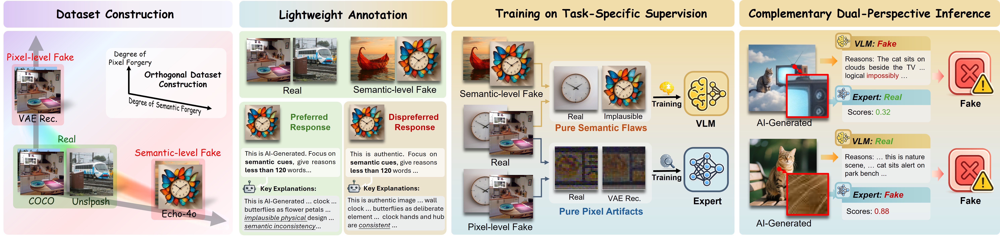
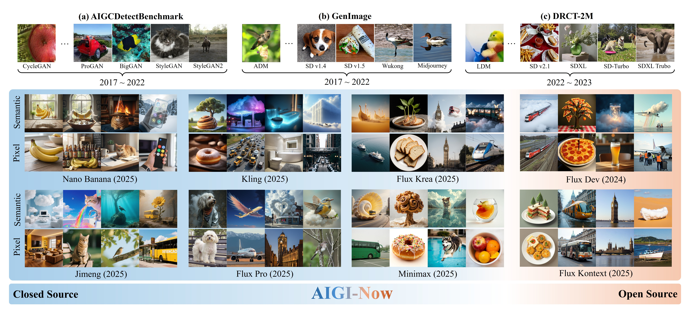

# Align, Don't Blend: Orthogonal Supervision Disentanglement As the Key to Generalizable AI-Generated Image Detection

[Project Page](https://github.com/GzZning/Align-Dont-Blend) | [arXiv](https://arxiv.org/abs/2512.06746)

This repository is the official implementation of "Align, Don't Blend: Orthogonal Supervision Disentanglement As the Key to Generalizable AI-Generated Image Detection".



## Training data

The VLM branch uses 5,000 Unsplash real images and 5,000 semantically implausible Echo-4o images with DPO preference records ([Hugging Face](https://huggingface.co/datasets/Gaffeyzz/Align-Dont-Blend-Semantic-Preference-10K)). The pixel-artifact expert uses COCO images and their VAE reconstructions; its [training data](https://huggingface.co/datasets/Junwei-Xi/DDA-Training-Set) are available from Dual Data Alignment.

## Training

### VLM branch

We recommend ms-swift 3.10.x. Set `SEMANTIC_DATASET` to the downloaded preference records with local image paths; [prepare_data.py](tools/prepare_data.py) can resolve those paths.

```bash
VLM_MODEL=/path/to/Qwen2.5-VL-7B-Instruct \
SEMANTIC_DATASET=/path/to/semantic_preference_train.jsonl \
OUTPUT_DIR=/path/to/output \
bash train_vlm.sh
```

## Inference

Run on an image folder:

```bash
python predict.py --input /path/to/images --output predictions.jsonl \
  --vlm-adapter weights/vlm_adapter \
  --vlm-base-model /path/to/Qwen2.5-VL-7B-Instruct
```

`predictions.jsonl` contains each image path, final decision, expert decision, VLM decision, and VLM response. The expert is optional; without it, the VLM makes the final decision. See the [expert example](extra/pixel_artifact_expert/README.md#dda-example) to add one.

## New Challenging Benchmark

AIGI-Now is available on [ModelScope](https://www.modelscope.cn/datasets/GaffeyGao/AIGI-Now) and [Hugging Face](https://huggingface.co/datasets/Gaffeyzz/AIGI-Now).



## Citing

If you find this work useful, please cite the following works.

```bibtex
@inproceedings{chen2026aligndontblend,
  title={Align, Don't Blend: Orthogonal Supervision Disentanglement As the Key to Generalizable AI-Generated Image Detection},
  author={Chen, Ruoxin and Gao, Jiahui and Lin, Kaiqing and Zhang, Keyue and Zhao, Yandan and Guan, Isabel and Yao, Taiping and Ding, Shouhong},
  booktitle={Proceedings of the 34th ACM International Conference on Multimedia},
  year={2026}
}

@inproceedings{chen2025dual,
  title={Dual Data Alignment Makes {AI}-Generated Image Detector Easier Generalizable},
  author={Ruoxin Chen and Junwei Xi and Zhiyuan Yan and Ke-Yue Zhang and Shuang Wu and Jingyi Xie and Xu Chen and Lei Xu and Isabel Guan and Taiping Yao and Shouhong Ding},
  booktitle={The Thirty-ninth Annual Conference on Neural Information Processing Systems},
  year={2025},
  url={https://openreview.net/forum?id=C39ShJwtD5}
}
```
