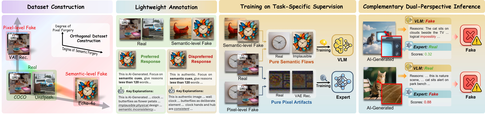
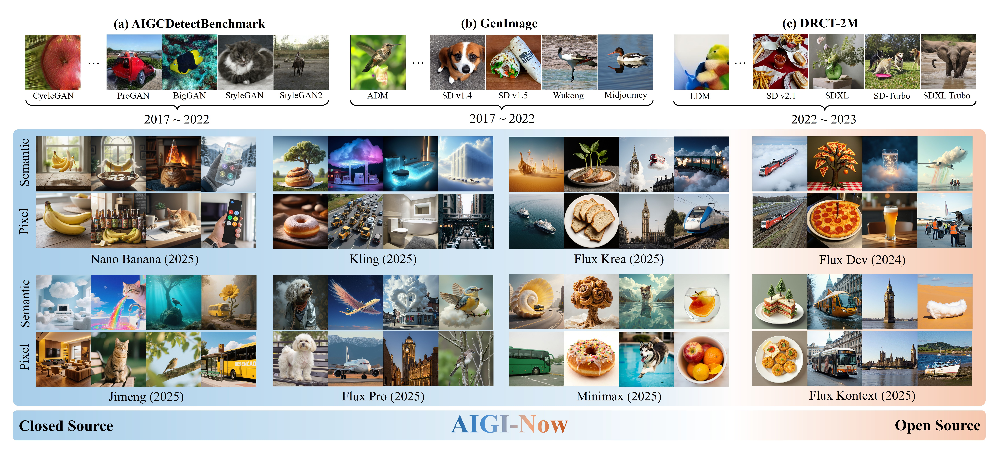

# Align, Don't Blend: Orthogonal Supervision Disentanglement As the Key to Generalizable AI-Generated Image Detection

[Project Page](https://github.com/GzZning/Align-Dont-Blend) | [arXiv](https://arxiv.org/abs/2512.06746)

This repository is the official implementation of "Align, Don't Blend: Orthogonal Supervision Disentanglement As the Key to Generalizable AI-Generated Image Detection".



## Training data

The VLM branch uses 5,000 Unsplash real images and 5,000 semantically implausible Echo-4o images with DPO preference records ([Hugging Face](https://huggingface.co/datasets/Gaffeyzz/Align-Dont-Blend-Semantic-Preference-10K)). The pixel-artifact expert uses COCO images and their VAE reconstructions ([ModelScope](https://www.modelscope.cn/datasets/JunweiXi/DDA-Training-Set) | [Hugging Face](https://huggingface.co/datasets/Junwei-Xi/DDA-Training-Set)).

## Training

### VLM branch

We used ms-swift 3.10.x. Set `SEMANTIC_DATASET` to the downloaded preference records with local image paths; [prepare_data.py](tools/prepare_data.py) can resolve those paths.

```bash
VLM_MODEL=/path/to/Qwen2.5-VL-7B-Instruct \
SEMANTIC_DATASET=/path/to/semantic_preference_train.jsonl \
OUTPUT_DIR=/path/to/output \
bash train_vlm.sh
```

## Inference

Tested PyTorch environment (Python 3.12):

```bash
pip install torch==2.6.0 torchvision==0.21.0 ms-swift==4.4.2 \
  transformers==5.12.1 peft==0.19.1 datasets==4.8.4 \
  qwen-vl-utils==0.0.14 accelerate==1.15.0 numpy==2.2.6 Pillow==11.3.0
```

Download the VLM adapter from [ModelScope](https://modelscope.cn/models/GaffeyGao/Align-Dont-Blend-VLM) or [Hugging Face](https://huggingface.co/Gaffeyzz/Align-Dont-Blend-VLM) into `weights/vlm_adapter/`. Download [Qwen2.5-VL-7B-Instruct](https://huggingface.co/Qwen/Qwen2.5-VL-7B-Instruct) into `weights/Qwen2.5-VL-7B-Instruct/`.

Download the [Expert](https://huggingface.co/Junwei-Xi/Dual-Data-Alignment/resolve/main/DDA_ckpt.pth) to `weights/DDA_ckpt.pth`.

Run VLM + DDA on an image folder:

```bash
python predict.py --input /path/to/images --output predictions.jsonl \
  --vlm-adapter weights/vlm_adapter \
  --vlm-base-model weights/Qwen2.5-VL-7B-Instruct \
  --infer-backend pt --torch-dtype float32 --attn-impl eager --device-map auto \
  --expert-command 'python -m detector.expert --checkpoint weights/DDA_ckpt.pth'
```

`predictions.jsonl` contains each image path, final decision, DDA decision, VLM decision, and VLM response.

The command above was tested on two 32 GB V100 GPUs. FP16 produced invalid responses in this setup.

## New Challenging Benchmark

AIGI-Now is available on [ModelScope](https://www.modelscope.cn/datasets/GaffeyGao/AIGI-Now) and [Hugging Face](https://huggingface.co/datasets/Gaffeyzz/AIGI-Now).



## License

The code and VLM adapter are licensed under [Apache-2.0](LICENSE).

## Citing

If you find this work useful, please cite the following works.

```bibtex
@inproceedings{chen2026aligndontblend,
  title={Align, Don't Blend: Orthogonal Supervision Disentanglement As the Key to Generalizable AI-Generated Image Detection},
  author={Chen, Ruoxin and Gao, Jiahui and Lin, Kaiqing and Zhang, Keyue and Zhao, Yandan and Guan, Isabel and Yao, Taiping and Ding, Shouhong},
  booktitle={Proceedings of the 34th ACM International Conference on Multimedia},
  year={2026}
}

@inproceedings{chen2025dual,
  title={Dual Data Alignment Makes {AI}-Generated Image Detector Easier Generalizable},
  author={Ruoxin Chen and Junwei Xi and Zhiyuan Yan and Ke-Yue Zhang and Shuang Wu and Jingyi Xie and Xu Chen and Lei Xu and Isabel Guan and Taiping Yao and Shouhong Ding},
  booktitle={The Thirty-ninth Annual Conference on Neural Information Processing Systems},
  year={2025},
  url={https://openreview.net/forum?id=C39ShJwtD5}
}
```
